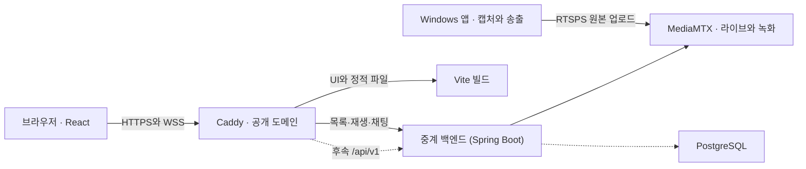

# FRAME 설계와 다음 작업 지시

2026-11-09 작성, 2026-11-11 관리 UI 기준과 OBS 기본 송출 방향 보강. 이 저장소의 설계·지시 문서다. 화면의 기능과 상태는 시안을 따르고, 관리 화면의 배치와 공통 요소는 아래 최신 UI 기준을 함께 따른다.

이전 문서는 2026-11-09에 정리했다. 대상은 루트의 `CLAUDE_*.txt`·`START_HERE.txt`·`UI_HANDOFF.txt`·`FEATURE_ROADMAP.txt`·`FEATURE_BACKLOG.csv`, 시안 폴더의 인계·README·용어 문서와 archive 폴더, `docs/inventory`다. 원문은 저장소 밖의 `frame-docs-backup-2026-11-09.zip`과 git 이력(커밋 `4c00651`)에 있다. 이 문서와 다르면 이 문서를 따른다.

1장은 현재 상태, 2장은 지켜야 할 제약, 3장은 구현 설계, 4장은 상세 설계 지시, 5장은 첫 구현과 Claude 인계다.

## 1. 기준 자료와 현재 상태

### 기준 자료

| 무엇 | 어디 |
| --- | --- |
| 화면 시안 | [design/2026-10-28/dist/index.html](../design/2026-10-28/dist/index.html). 화면 보드는 [board-v3.html](../design/2026-10-28/dist/board-v3.html), [settings-board.html](../design/2026-10-28/dist/settings-board.html). 로컬 확인: `node design/2026-10-28/serve.mjs` 실행 후 `http://127.0.0.1:5328/` |
| 화면·상태 목록 | [design-manifest.json](../design/2026-10-28/design-manifest.json)의 `screens[]`(화면마다 `states`). 시안에 그려진 상태가 기준이다 |
| 플레이어 보존 기준 | [PLAYER_PRESERVATION.json](../design/2026-10-28/PLAYER_PRESERVATION.json), 실제 재생 코드 [console-ux.js](../work/console-ux.js) |
| 중계 서버 | Spring Boot 백엔드 [apps/api](../apps/api/README.md): [BroadcastController](../apps/api/src/main/java/frame/api/broadcast/BroadcastController.java), [BroadcastRegistry](../apps/api/src/main/java/frame/api/broadcast/BroadcastRegistry.java), [PlaybackController](../apps/api/src/main/java/frame/api/playback/PlaybackController.java), [HlsUpstream](../apps/api/src/main/java/frame/api/playback/HlsUpstream.java), [Recordings](../apps/api/src/main/java/frame/api/dvr/Recordings.java), [Ladders](../apps/api/src/main/java/frame/api/quality/Ladders.java), [ChatHub](../apps/api/src/main/java/frame/api/chat/ChatHub.java). 이전 Node 구현 [relay.mjs](../server/relay.mjs)는 배포하지 않고 검증의 비교 기준으로 둔다 |
| Windows 앱 | [native/README.md](../native/README.md), LAN 시청 서버 [http_server.cpp](../native/src/http_server.cpp), 배포 안내 [packaging/README.txt](../packaging/README.txt) |
| 배포와 측정 | [deploy/DESIGN.md](../deploy/DESIGN.md), [deploy/README.md](../deploy/README.md), [verification/REPORT.md](../verification/REPORT.md), Spring 백엔드 검증 [verification/spring/RESULTS.md](../verification/spring/RESULTS.md) |

### 관리 화면 공통 UI (2026-11-11 사용자 피드백 반영)

관리 화면은 [ManagementUI.tsx](../apps/web/src/components/management/ManagementUI.tsx)와 [공통 스타일](../apps/web/src/components/management/ManagementUI.module.css)을 재사용한다. 이전 화면의 개별 외곽·제목·버튼·표 스타일을 새 화면에 복사하지 않는다.

- `ManagementPage`가 배경, 외곽 여백, 제목과 작업 버튼의 위치를 맡는다. 제목 위에 “방송 스튜디오”를 반복하지 않는다. 메뉴명과 화면 제목을 맞추고, 방송하기의 진행 상태는 제목을 바꾸는 대신 배지로 표시한다.
- 입력·탭·버튼·표·작은 대화상자는 공통 `ui` 클래스를 쓴다. 검색창 테두리는 `ui.search`, 개별 입력은 `ui.control`로 구분하며 체크박스·스위치·슬라이더에 일반 입력 스타일을 덮지 않는다. 오류는 해당 필드에 연결하고, 읽기 전용과 비활성 상태를 구분한다.
- 상태는 `StatusBadge`, 빈 목록은 `EmptyState`를 쓴다. 표는 숫자 정렬, 행 선택·포커스, 모바일의 항목/값 배치를 통일한다. 표의 데이터와 행은 일반 JSX로 유지하며 별도 컬럼 설정 엔진을 만들지 않는다.
- 메뉴는 방송, 채널 운영, 시청자 참여, 성과, 연동으로 묶는다. 미디어 재생·송출 계약과 플레이어 보존 범위는 이 정리의 영향을 받지 않는다.
- 일반 방송자용 웹 화면은 서버 주소·포트·전송 프로토콜을 직접 입력받지 않는다(2026-11-11 사용자 피드백). 이전 시안의 `connection` 입력창은 그대로 이식하지 않고, 연결 상태와 복구 안내로 구성한다. 플랫폼이 제공하는 송출 주소·키는 방송하기의 송출 정보에 모으고, 외부 도구 연결도 이 화면으로 연결한다.

### OBS 기본 송출 결정 (2026-11-11 사용자 요청)

- 기본 방송 도구는 OBS다. 방송자 PC의 화면·게임 캡처, 장면 구성, 시스템 소리·마이크, 해상도·프레임률·인코더·비트레이트 설정은 OBS가 맡는다. 웹 스튜디오는 송출 주소·키 복사, 수신 미리보기, 방송 정보·채팅·수신 상태를 관리한다.
- 기존 C++ Windows 앱과 `native/`, 앱 UI·빌드·패키징은 보존한다. OBS 기본 송출로 전환하기 위해 해당 앱을 삭제하거나 수정하지 않는다. 이전 앱·LAN 설명과 시안의 화면 선택·인코더 설정은 이 기존 경로의 기록이며, 새 웹 방송 준비 화면에 그대로 옮기지 않는다.
- 방송은 OBS 송출 신호에 따라 자동으로 시작·종료 상태를 표시한다. 서버가 공개 전 수신과 공개 시작을 실제로 구분하는 계약을 갖추기 전에는 별도의 웹 방송 시작 버튼이나 비공개 사전 미리보기를 제공하는 것처럼 표시하지 않는다.
- 송출 주소·키는 플랫폼이 제공하는 읽기 전용 정보다. 실제 키는 인증된 관리 계약에서만 제공하며, 일반 목록이나 미리보기 데이터·브라우저 저장소·소스 코드에 넣지 않는다. 웹에서는 OBS의 화면 선택·소리 조절·장면 전환을 제어하는 것처럼 보이는 조작을 추가하지 않는다.
- 이 PC의 방송 준비 화면은 실제 로컬 서버와 연결한다. `node server/obs-local.mjs start`가 저장소 밖 `%LOCALAPPDATA%/Frame/obs-local/studio.json`에 송출 자격 증명을 보관한다. 2026-11-11 계정 기능을 추가했으며 제품 모드의 관리 요청에는 공용 운영자 토큰을 주입하지 않는다. 로그인한 사용자가 기존 OBS 키로 소유권을 증명해 자기 채널에 연결한 뒤 `/api/v1/studio`에서 송출 정보와 측정값을 받는다. HLS·채팅은 기존 시청 컨트롤러를 유지한다. 자세한 실행은 [OBS 안내](../deploy/OBS.md), [계정 API](../apps/api/PRODUCT_API.md), [로컬 DB·Redis](../deploy/PRODUCT_LOCAL.md)를 따른다.
- 사용자 요청에 따라 화면의 예시·미리보기 안내 문구를 제거한다. 영상 확인·채널 편집 결과 등 실제 기능의 미리보기 명칭은 유지한다. 일반 개발·배포 화면은 실제 회원가입·로그인·채널·팔로우 API를 사용하며, 디자인 모드와 포트폴리오는 별도의 가상 데이터를 유지한다. 미구현 메뉴에서는 가짜 저장·성과·거래를 표시하지 않는다. Toss 테스트 결제의 기존 운영자 API는 유지하지만 계정별 결제 소유권으로 이관하기 전에는 일반 회원 화면에서 운영자 거래내역을 공유하지 않는다. 환불·정산·개발자 키 발급·계정 복구는 실제 연결 전까지 성공 처리하지 않는다.
- 장면 관리의 기존 경로·코드는 기존 앱용 미리보기로 보존하고 기본 크리에이터 메뉴에서 제외한다. 녹화 관리는 FRAME 서버의 방송 녹화를 보여주며, OBS가 방송자 PC에 저장한 로컬 파일과 구분한다.

참고한 흐름은 플랫폼 제공 URL·키를 인코더에 넣는 [유튜브](https://support.google.com/youtube/answer/2907883?hl=en), 송출 소프트웨어에서 방송을 시작·종료하는 [치지직](https://help.naver.com/service/30044/contents/22587?lang=ko&osType=COMMONOS), OBS 계정 연결을 안내하는 [트위치](https://help.twitch.tv/s/article/enhanced-broadcasting?language=en_US)다. 색·여백·공통 컴포넌트는 FRAME의 기존 기준을 유지한다.

### 현재 구현 상태 (2026-11-09)

- **Windows 앱**: 창이나 모니터를 캡처해 송출한다. 같은 망에서는 이 PC가 직접 시청 서버가 된다.
  - 캡처는 Windows Graphics Capture, 인코딩은 FFmpeg(NVENC 등), 영상은 H.264 1초 GOP, 음성은 Opus + AAC다.
  - 송출은 RTSP로 앱 안의 MediaMTX에 보낸다.
- **일반 시청은 LL-HLS다.** hls.js 1.5.20을 쓰고, 안 되면 Safari 기본 HLS를 쓴다. WebRTC(WHEP)는 데스크톱 앱 자체 수신과 HLS를 전혀 못 쓰는 브라우저에만 쓴다.
- **화질은 화질 래더가 만든다.** 방송마다 FFmpeg 하나가 원본 복사본과 720/480/360/240p를 같은 시계로 만든다. 방송 시작과 함께 뜨고, 5분 유휴면 멈추며, 실패하면 원본만 광고한다.
- **되감기**: 방송 녹화(영상 + AAC, 재인코딩 없음)로 만든 `dvr.m3u8`로 방송 처음까지 되감는다.
- **채팅**: 방송별 게스트 채팅이 있다.
- **인터넷 시청**: 중계 서버(Spring Boot 백엔드 `apps/api` + MediaMTX, 앞단 Caddy)가 같은 계약으로 제공한다.
- **측정** (같은 PC 루프백, [REPORT.md](../verification/REPORT.md)의 HLS 전환 절)
  - LL-HLS 실제 지연 1.65 s(WebRTC 0.13 s), 첫 화면 0.42 s.
  - 고움직임 8.6 Mbps 원본에서 100명까지 원본 속도 100%. 이전 WebRTC는 25명이 한계였다.
  - 중계 e2e 93/93 통과.
- **미검증**: iPhone·Android 실기기, 다른 PC·인터넷 회선, CDN, 1,000명, 앱을 거친 오디오 전체 경로, 회선 조건별 자동 화질.
- **다음 단계**: 공개 시청 React 화면의 실제 중계 연결(5장)과 중계의 Spring Boot 이식은 끝났다([REPORT.md](../verification/REPORT.md) 2026-11-09 절, [verification/spring/RESULTS.md](../verification/spring/RESULTS.md)). 남은 것은 실기기와 Linux 서버 확인, 그리고 4장의 제품 API 상세 설계다.

## 2. 지켜야 할 제약

이전 지시 문서들에서 지금도 유효한 것만 모았다.

- **무료 시험 조건이다.** 유료 서버·CDN·DB·인증 서비스를 임의로 계약하거나 자동 업그레이드하거나 유료 트래픽을 쓰지 않는다. 유료가 필요해지는 지점은 비용과 무료 대안만 기록한다.
- **권한을 분리한다.**
  - 시청·송출·관리 권한을 나눈다.
  - 공개 서버에 MediaMTX 관리 API나 네이티브 시작·중지 명령을 노출하지 않는다.
  - 개인 키와 서버 비밀값은 UI와 저장소에 넣지 않는다.
  - 인터넷에 노출되는 송출·관리 기능에는 최소한의 인증과 권한 검사가 있어야 한다.
- **우회 경로를 만들지 않는다.** 인증 실패와 시청자 상한을 다른 프로토콜(WHEP 등)이나 다른 주소로 우회할 수 없게 한다.
- **전송 방향은 확정됐다.** 일반 시청은 HLS, 저지연이 필요한 용도만 WebRTC다. 다시 비교하거나 결정하지 않는다.
- **1,000명은 따로 다룬다.**
  - 한 방송 동시 1,000명과 CDN은 UI 전환 완료 기준과 분리해 측정한다.
  - 같은 PC 루프백 결과, API 요청 수, 채팅 연결 수를 인터넷 영상 시청 1,000명으로 보고하지 않는다.
  - 작은 인원 결과를 외삽하지 않는다.
  - HLS라는 이유만으로 1,000명을 지원한다고 쓰지 않는다.
- **UI 보존 규칙**
  - `reference/`, `reference-v05/`, `design/2026-10-28/preserved-player/`와 UI 잠금 파일(`UI_LOCK.json`, `UI_V05_LOCK.json`, `UI_V0*_ADDENDUM.json`)은 보존한다.
  - 허용된 변경은 addendum으로 따로 기록하고, 기존 해시를 덮어써 "변경 없음"으로 만들지 않는다. 검사는 `tools/verify-ui-v061.mjs`다.
- **시험 자료**: 시험에는 시험용 영상·음성만 쓰고, 실제 화면을 외부에 공개하지 않는다.
- **작업 규칙**
  - 이 PC는 게임과 함께 쓴다. 무거운 시험(앱 실행, 부하, e2e)은 하나씩 돌린다.
  - 커밋·푸시는 요청받았을 때만 한다. 절차는 `dev-kjy` → `main` fast-forward 병합 → 작업 브랜치 삭제이고, 커밋 메시지는 한국어다.

## 3. 구현 설계

첫 React 구현 범위는 **공개 웹의 라이브 목록 → 실제 방송 재생 → 게스트 채팅 → 되감기 → 실시간 복귀**다. Windows 앱이 이미 송출한 방송을 기존 중계 서버에서 받아 화면을 붙인다. 계정 없이 이 흐름이 끝까지 동작하면, 같은 화면 구조 위에 Windows 방송하기와 계정·채널 기능을 단계적으로 연결할 수 있다.

화면은 시안의 v55 셸과 [design-manifest.json](../design/2026-10-28/design-manifest.json)의 화면·상태를 기준으로 한다. 플레이어 동작은 [보존 기준](../design/2026-10-28/PLAYER_PRESERVATION.json)과 [실제 재생 코드](../work/console-ux.js)를 따른다. 시안의 계정, 통계, 채팅 데이터는 화면 검토용이다.

### 3.1 플랫폼 API 비교

네 플랫폼이 외부 개발자에게 공개한 문서의 요청·응답을 비교했다.
- SOOP의 예시는 공식 개발자 페이지가 렌더링하는 문서에서 확인했다.
- 플랫폼별 인증과 응답은 문서 기준이다. FRAME의 요청·응답은 아래에서 따로 제안한다.

| 플랫폼 | 조회 요청과 응답 | FRAME에 참고할 점 |
| --- | --- | --- |
| 유튜브 | `GET /youtube/v3/search?part=snippet&type=video&eventType=live&pageToken=…` → `{items,nextPageToken,…}`. 영상 리소스의 `liveStreamingDetails`에 시작·종료 시각, 조건부 동시 시청자 수와 활성 채팅 ID가 있다. 방송 관리에서는 `liveBroadcast`와 재사용 가능한 `liveStream`을 따로 다룬다. [검색](https://developers.google.com/youtube/data/reference/rest/v3/search/list) · [영상](https://developers.google.com/youtube/data/reference/rest/v3/videos#liveStreamingDetails) · [방송과 스트림](https://developers.google.com/youtube/data/live/broadcasts-and-streams) | 목록은 카드용 요약으로 만들고 방송 ID를 재사용하는 송출 경로와 구분한다. |
| SOOP | `GET /broad/list?client_id=…&order_type=broad_start&page_no=1` → `{total_cnt,page_no,page_block,broad,time}`. `broad[]`에는 `broad_no`, `user_id`, 제목과 썸네일 등이 있다. 계정 연동 상태 조회는 폼 본문에 토큰을 넣는 `POST /validate/live/status`이며, 문서 예시에서 `data.status`는 `streaming` 또는 `streamend`다. [방송 목록](https://developers.sooplive.com/docs/api/broad-watch#broad-list) · [방송 상태](https://developers.sooplive.com/docs/api/broad-watch#broad-status-intro) | 목록과 계정별 방송 상태 조회의 권한과 용도를 구분한다. 방송 번호와 방송자 ID를 분리하고, 시청 링크가 특정 방송을 가리키게 한다. |
| 치지직 | 앱 인증 `GET /open/v1/lives?size=20&next=…` → `{code,message,content:{data,page:{next}}}`. 카드에 필요한 `liveId`, `channelId`, 채널명·이미지, 카테고리, 현재 시청자 수가 함께 온다. 채팅 전송은 `POST /open/v1/chats/send`, 실시간 수신은 별도 세션 이벤트다. [라이브](https://chzzk.gitbook.io/chzzk/chzzk-api/live) · [공통 응답](https://chzzk.gitbook.io/chzzk/chzzk-api/tips) · [채팅](https://chzzk.gitbook.io/chzzk/chzzk-api/chat) · [세션](https://chzzk.gitbook.io/chzzk/chzzk-api/session) | 목록에 채널 요약을 포함하고 채팅 전송 결과와 모두에게 전달되는 메시지 이벤트를 구분한다. |
| 트위치 | 앱 또는 사용자 토큰으로 `GET /helix/streams?first=20&after=…` → `{data,pagination}`. 방송 `id`와 방송자 `user_id`가 별도다. 시청자 수 정렬에서 페이지 간 중복·누락이 생길 수 있다고 명시한다. 팔로우한 채널과 현재 방송 중인 팔로우 채널은 각각 조회할 수 있고, EventSub는 별도 수신 경로다. [라이브](https://dev.twitch.tv/docs/api/reference/#get-streams) · [팔로우 채널](https://dev.twitch.tv/docs/api/reference/#get-followed-channels) · [팔로우 라이브](https://dev.twitch.tv/docs/api/reference/#get-followed-streams) · [EventSub](https://dev.twitch.tv/docs/eventsub/handling-websocket-events/) | 다음 페이지는 서버가 발급한 커서로 받고, 기본 정렬은 시작 시각과 방송 ID를 사용한다. 팔로우 관계와 현재 방송 상태의 수명을 구분한다. |

FRAME 제품 API의 방향은 이렇다.
- 성공 응답은 리소스 하나이거나 `{items,nextCursor}`다.
- 방송 카드에 채널 요약을 포함해, 카드 수만큼 조회가 늘지 않게 한다.
- 재생에 필요한 정보는 시청에 들어갈 때 요청한다.

### 3.2 기술 스택과 실행 구조

| 영역 | 선택 | 적용 범위 |
| --- | --- | --- |
| 공개 웹 | React + strict TypeScript + [Vite](https://vite.dev/guide/build) | 첫 시청 화면은 브라우저에서 기존 API를 조회한다. Caddy가 정적 빌드를 제공하므로 웹 렌더링 프로세스를 추가할 필요가 없다. |
| 주소와 서버 데이터 | [React Router Declarative Mode](https://reactrouter.com/start/modes) + [TanStack Query](https://tanstack.com/query/latest/docs/framework/react/guides/important-defaults) | 라우터는 주소·뒤로 가기, Query는 목록·방송 정보·재시도에 사용한다. 플레이어와 WebSocket 수명은 각각의 컨트롤러가 관리한다. |
| 스타일 | CSS 변수 + CSS Modules, 로컬 Pretendard | 최신 시안의 브랜드·색·간격과 기존 플레이어 조작을 옮긴다. 리뷰 바와 시안의 버전별 CSS 덮어쓰기는 가져오지 않는다. |
| 영상과 채팅 | 기존 C++17 + WebView2 + FFmpeg + MediaMTX, 중계 백엔드(Spring Boot, `apps/api`) | 브라우저 시청은 LL-HLS. 기존 플레이어처럼 hls.js 지원을 확인하고, 사용할 수 없으면 Safari 등에서 브라우저 기본 HLS를 확인한다. WebRTC/WHEP는 기존 초저지연·호환 경로로 둔다. 채팅은 기존 WebSocket을 연결한다. [재생 방식 선택](../work/console-ux.js) · [hls.js 호환성](https://github.com/video-dev/hls.js#compatibility) |
| 계정과 채널 단계 | 중계와 같은 Spring Boot 프로세스(`apps/api`), [PostgreSQL](https://www.postgresql.org/docs/current/ddl-constraints.html), Redis | 2026-11-11 실제 계정·채널·팔로우 저장을 구현했다. PostgreSQL은 관계 제약과 트랜잭션, Redis는 Spring Session 로그인 세션과 만료를 맡는다. 제품 API는 기존 Spring Boot 프로세스에 두며 JWT·별도 인증 서버·이벤트 버스는 추가하지 않는다([계정 API](../apps/api/PRODUCT_API.md)). |

**Next.js를 고르지 않은 이유**: Next.js도 정적 배포가 가능하다. 하지만 App Router 정적 내보내기에서 방송별 동적 페이지를 만들려면 빌드 시점에 경로를 알아야 한다. 새 방송이 즉시 생기는 첫 시청 화면에는 SPA가 맞는다. 채널·VOD 검색 노출이나 방송별 공유 미리보기가 필요해지면, 해당 페이지에 서버 렌더링이나 메타데이터 응답을 추가하는 비용을 그때 비교한다. [Next.js 정적 내보내기 제약](https://nextjs.org/docs/app/guides/static-exports#unsupported-features)

**빌드 기준**
- 웹 빌드는 Node.js 24 LTS와 Yarn Berry를 기준으로 한다. `apps/web/package.json`에 Yarn 버전을 고정하고 `yarn.lock`으로 의존성을 관리한다. 설치는 `yarn install --immutable`, 타입 검사는 `yarn typecheck`를 사용한다. 설치 방식은 `node_modules`다.
- 첫 재생 검증은 저장소의 hls.js 1.5.20을 비교 기준으로 삼아, 이식 문제와 라이브러리 버전 변경을 구분한다.
- 실제 채택 버전은 보안·호환성을 확인하고, Safari·Android 실기기에서 음성·화질 전환·되감기를 확인한 뒤 고정한다.
- 참고: [Node.js 지원 일정](https://nodejs.org/en/about/previous-releases) · [Vite 타입 검사](https://vite.dev/guide/features.html#typescript) · [Yarn 설치](https://yarnpkg.com/getting-started/install) · [Yarn 잠금 파일 검증](https://yarnpkg.com/cli/install) · [현재 의존성](../deps/manifest.json)



### 3.3 화면 주소와 코드 구조

기존 링크와 함께 검증하는 동안 새 웹은 `/_frame/` 아래에 둔다. 기존 스트림 경로는 영문자나 숫자로 시작하므로 `_frame`과 충돌하지 않는다.
- [Caddy](https://caddyserver.com/docs/caddyfile/patterns#single-page-apps-spas)는 아래 UI 주소의 HTML 요청만 SPA로 돌린다.
- Vite의 `base`와 라우터의 `basename`을 맞춘다.
- 해시가 있는 자산은 장기 캐시, HTML은 재검증으로 배포한다. 없는 자산은 404로 답한다.
- `/api/*`, HLS, DVR, WSS, 기존 `/:path`는 지금처럼 중계 서버가 처리한다.

| 첫 화면 주소 | 동작 |
| --- | --- |
| `/_frame/live` | 현재 볼 수 있는 라이브 목록. 로딩, 정상 빈 목록, 불러오기 실패를 구분한다. |
| `/_frame/watch/:streamPath/:broadcastId` | 목록 카드와 새 공유 링크의 시청 주소. 새로고침해도 목록 조회 없이 방송 정보를 확인한다. 방송 ID가 바뀌면 이전 링크에서 새 방송을 자동으로 열지 않는다. |
| `/:path` | 기존 방송 링크. 시범 배포 중 그대로 제공한다. |

예를 들어 `studio-a`는 재사용할 수 있는 송출 경로이고, `8f10ab23765d4cc1b730120056ff0091`은 그 경로에서 한 번 시작한 방송의 ID다. 채널의 공개 주소나 로컬 녹화 파일 이름에 둘을 대신 쓰지 않는다. 공개 웹에서 공유하는 링크는 서버에 설정한 공개 도메인의 시청 주소를 사용한다.

```text
apps/web/
  src/
    app/                 라우터, 공통 셸, Query 설정
    features/live/       라이브 목록과 카드
    features/watch/      시청 화면, 정보·공유 UI와 화면 상태
    features/playback/   video 연결, HLS·WHEP, DVR, 시청 세션
    features/chat/       채팅 연결, 닉네임, 메시지·전송 상태
    shared/api/          fetch, 응답 검증, relay 응답 변환, 오류 분류
    shared/ui/           색·간격·글꼴과 공통 UI
  e2e/                   웹에서 확인하는 실제 시청 흐름
apps/api/                Spring Boot 백엔드: 중계와 제품 API, 자체 Gradle Wrapper (apps/api/README.md)
server/                  검증 스크립트와 이전 Node 중계(배포하지 않음, 검증의 비교 기준)
native/                  기존 Windows 캡처·송출과 WebView2
work/, outputs/, deps/   송출 앱의 콘솔 UI 소스, UI 빌드 결과, 고정 의존성 (native/README.md "native/ 밖의 빌드 입력")
deploy/                  Caddy와 서버용 MediaMTX 설정
verification/            검증 결과
```

세 앱(`apps/web`, `apps/api`, `native`)은 서로의 소스 폴더를 읽지 않고 아래 계약으로만 연결한다. 나중에 각자의 저장소로 옮겨도 이 계약은 그대로다.
- 송출 앱 → 백엔드: `POST /api/broadcasts/announce`(Bearer 토큰, 2초마다), `PUT /api/broadcasts/<id>/thumbnail`, `GET /<path>/info`, RTSPS 송출(중계 MediaMTX), 송출 화면의 채팅 WebSocket.
- React → 백엔드: 같은 출처의 `/api/*`, `/<path>/info`, `/<path>/b/<id>/...`(HLS·세션·DVR), `/<path>/chat` WebSocket, WHEP. 개발 서버는 `FRAME_RELAY_URL`로 백엔드를 고른다.
- Caddy: `/_frame/`은 React 빌드 파일을 직접 제공하고 나머지는 백엔드로 넘긴다(`deploy/test/Caddyfile.https-test`).
- 기존 `/<path>` 시청 화면(`outputs/index.html`)은 백엔드가 `RELAY_UI_FILE`로 받은 파일 경로에서만 읽는다(Spring은 기본값 없음, Node 중계는 `outputs/index.html`이 기본).

역할 분담은 이렇다.
- React는 화면과 컨트롤을 렌더링한다.
- `playback`은 `<video>` 하나를 소유하는 컨트롤러다. 현재 재생 코드의 URL 처리, 자동·수동 화질, 재시도, DVR 규칙을 여기로 옮긴다.
- `work/console-ux.js`는 전역 DOM을 참조하므로 스크립트 전체를 React 화면에 넣지 않는다.
- 채팅을 접거나 확대 보기로 바꿔도 영상 요소와 연결을 다시 만들지 않는다. 방송을 바꾸거나 페이지를 떠날 때만 요청을 취소하고 플레이어·시청 세션·채팅을 정리한다.

### 3.4 첫 구현에서 쓰는 기존 중계 API

공개 웹은 같은 도메인의 기존 API를 호출하고, 개발 서버도 같은 경로를 중계 서버에 프록시한다. 목록의 `baseUrl`은 공개 웹에서 임의의 접속 대상으로 쓰지 않는다. 이 필드는 각 PC가 직접 시청을 제공하는 기존 LAN 목록에도 쓰이기 때문이다.

| 요청 | 현재 응답과 웹에서 쓰는 방식 |
| --- | --- |
| `GET /api/broadcasts` | 200 `{items:[...]}`. 중계 서버가 미디어를 받고 있는 방송 목록이다. `id`를 카드 키로 쓴다. 썸네일이 404이면 기본 이미지로 표시한다. |
| `GET /:path/info` | 200. `running:true, mediaReady:true`면 재생을 준비한다. `running:true, mediaReady:false`면 신호 대기이며, `Retry-After`를 읽어 다시 확인한다. `running:false`는 현재 재생 불가다. 이 값만으로 방송자가 종료한 것인지 중계의 대기 시간이 끝난 것인지 구분할 수 없다. |
| `POST /:path/session` | HLS 재생 전에 연다. 200 `{sid,heartbeatMs:15000}`. 응답 주기대로 `PUT /:path/session/:sid`를 보내고, 떠날 때 `DELETE`를 시도한다. 204에는 본문이 없다. 하트비트 404는 방송 ID를 다시 확인한 뒤 같은 방송이면 재발급한다. 새 세션의 429·503은 `Retry-After` 이후 재시도한다. |
| `GET /:path/live.m3u8` | `info.hls.master`에서 얻는 HLS 재생 목록. 자동 화질은 재생 목록과 플레이어에 맡기고, Safari 기본 HLS의 수동 화질에는 서버가 지원하는 `?q=720p` 등의 단일 화질 목록을 사용한다. |
| `GET /:path/dvr`, `GET /:path/dvr.m3u8` | JSON 인덱스에서 현재 방송 ID와 녹화 범위를 확인한 뒤 HLS DVR로 탐색한다. 활성화돼 있어도 범위가 비어 있으면 기다린다. 파일 응답의 409는 방송 ID가 달라졌다는 뜻이므로 이전 구간을 계속 요청하지 않는다. |
| `WS /:path/chat` | `join`에서 `broadcastId`를 보내 현재 방송 방에 접속한다. `state`·`history`, 이후 `message`·`ack`·`name`·`closed`를 처리한다. |
| `POST /:path/whep` | 필요한 환경의 호환 경로. SDP로 연결하고 응답의 `Location`을 보관해 떠날 때 `DELETE`한다. HLS 시청 세션은 따로 열지 않는다. |

다음은 기존 목록 API가 보내는 한 항목의 예시다. 방송 이름과 식별자는 예시 값이다. `publisher`는 현재 방송이 보낸 표시 이름이며, 채널 ID나 로그인 정보가 아니다. 이 API에는 시청자 수가 없으므로 카드에 임의 숫자를 표시하지 않는다.

```json
{
  "items": [
    {
      "id": "8f10ab23765d4cc1b730120056ff0091",
      "title": "오늘의 작업 방송",
      "publisher": "FRAME 작업실",
      "baseUrl": "https://frame.example.com",
      "path": "studio-a",
      "thumbnailUrl": "https://frame.example.com/thumbnails/8f10ab23765d4cc1b730120056ff0091.jpg",
      "width": 1920,
      "height": 1080,
      "fps": 30,
      "running": true,
      "startedAtMs": 1794182400000
    }
  ]
}
```

`/:path/info`의 재생 가능 응답 중 화면과 플레이어가 함께 쓰는 필드는 아래와 같다(발췌).
- `startedAtMs`는 Unix epoch 밀리초, `bitrate`와 `renditions[].mbps`는 Mbps다.
- `hls`는 설정에 따라 없을 수 있다.
- 미디어 URL은 브라우저의 현재 페이지 주소가 아니라 `/<path>/`를 기준으로 해석한다.

```json
{
  "running": true,
  "mediaReady": true,
  "path": "studio-a",
  "broadcastId": "8f10ab23765d4cc1b730120056ff0091",
  "bitrate": 6,
  "dvr": true,
  "hls": { "master": "live.m3u8", "lowLatency": true, "audio": "aac", "dvr": "dvr.m3u8" },
  "renditions": [{ "name": "720p", "width": 1280, "height": 720, "mbps": 3.5, "fps": 30, "codec": "H.264" }]
}
```

`shared/api`가 지킬 규칙:
- JSON 형식을 확인하고, `id`와 `broadcastId`를 웹에서 일관된 이름으로 다룬다.
- 초기 목록이 200 + 빈 배열이면 빈 상태로, HTTP·네트워크 오류는 실패로 처리한다. 이미 본 목록이 있고 갱신만 실패했다면 마지막 목록을 남긴다.
- 기존 API의 오류 본문은 JSON, 텍스트, 빈 응답이 섞이므로 HTTP 상태와 `Retry-After`를 먼저 본다.
- 목록·정보 조회는 활성 화면에서만 갱신한다. 429·503 재시도를 Query와 플레이어가 중복으로 하지 않게 한다.
- API의 근거는 [중계 라우트 표](../apps/api/README.md), [DVR 인덱스](../apps/api/src/main/java/frame/api/dvr/Recordings.java), [채팅 프로토콜](../apps/api/src/main/java/frame/api/chat/ChatHub.java)이다.

시청 화면의 상태는 세 가지로 나눈다.

- **방송**: 확인 중, 신호 대기, 재생 가능, 현재 볼 수 없음, 다른 방송으로 교체됨.
  - 최초 연결과 재시도에서 방송 ID를 확인하고, 재생 중에도 정보를 갱신한다.
  - 중계가 응답하지 않으면 연결 오류로 표시한다.
- **플레이어**: 재생/일시정지, 라이브/지난 구간, 자동/수동 화질은 별개로 관리한다.
  - 재연결과 접속자 제한을 구분한다. 자동재생 정책에 막히면 소리 켜기 동작을 보여준다.
  - 실제 재생 위치와 화면 버튼의 상태는 플레이어 이벤트로 맞춘다.
- **채팅**: 채팅 실패가 영상 재생을 멈추게 하지 않는다.
  - 닉네임을 정하기 전에도 읽을 수 있고, 전송은 서버의 `ack`로 확인한다.
  - `clientId`는 전송 결과를 찾는 값으로만 쓰고, 응답이 유실된 메시지를 자동 재전송하지 않는다.
  - 재접속하면 받은 이력으로 목록을 다시 그린다. 메시지 ID로 중복을 거르는 것은 한 연결 안에서만 한다.
  - 중계가 재시작되면 메모리 이력이 사라지고 같은 방송에서 메시지 ID가 다시 매겨진다([채팅 구현](../apps/api/src/main/java/frame/api/chat/ChatHub.java)). 그래서 남은 이력만 중복 없이 보여주고, 잃은 구간은 초기화한다. 무손실 복구는 이력 저장과 재전송 계약이 필요한 후속 결정이다.
  - 브라우저 WebSocket은 실패한 HTTP 업그레이드 헤더를 읽을 수 없으므로, 간격을 늘려 가며 제한적으로 다시 연결한다.

시청 세션은 시청자 집계와 접속 제한을 위한 값이다.
- 떠날 때 삭제에 실패해도 서버에서 만료된다(기본 30초).
- 로그인 쿠키나 미디어 접근 권한으로 쓰지 않는다.
- 현재 HLS URL은 경로에 묶여 있어서, 클라이언트가 방송 ID를 확인하는 것만으로는 송출이 교체되는 순간까지 완전히 격리할 수 없다. 새 주소를 기본 공유 링크로 바꾸기 전에 미디어 URL과 캐시 키에 방송 ID를 넣고, 중계 서버가 ID가 맞는 방송의 미디어만 내주도록 검증한다.

### 3.5 후속 제품 API 초안

2026-11-11 구현: 회원가입·로그인·로그아웃, 세션 조회, 프로필·채널·배너 설정 저장, 공개 채널 검색, 팔로우·알림 설정, OBS 소유권 연결을 `/api/v1/*`에서 제공한다. 현재 요청·응답과 보안 규칙은 [PRODUCT_API.md](../apps/api/PRODUCT_API.md)가 기준이다. 아래 표에는 이후 방송·다시보기 제품 API를 포함한 기존 설계 후보도 남겨 두었다.

제품 데이터는 같은 공개 도메인의 `/api/v1/*` 아래 별도 API로 제공한다.
- 아래 요청은 상세 설계를 위한 후보다. 첫 React 구현은 3.4절의 중계 API로 진행한다.
- PostgreSQL에는 계정과 채널 관계, 방송의 제품 메타데이터를 둔다. 재생 준비 상태는 중계 서버에서 확인한다.
- Caddy는 제품 JSON 요청(`/api/v1/*`)과 HLS·SDP·WebSocket을 모두 같은 Spring Boot 백엔드로 보낸다(3.2절, 2026-11-10 결정).

| 데이터 | 경계 |
| --- | --- |
| 계정·프로필, 로그인 연결 | 계정의 내부 ID와 제공자의 발급자·사용자 ID 조합으로 연결한다. 프로필의 표시 이름과 채널 공개 주소를 독립적으로 다룬다. |
| 채널·기기·팔로우 | 채널 ID를 기준으로 소유자·운영자 권한을 확인한다. 송출 기기나 자격 증명을 채널에 연결한다. 팔로우는 `(user_id, channel_id)`를 고유하게 둔다. |
| 방송·공개 다시보기 | 방송 한 회차의 ID, 재사용되는 송출 경로, 공개 다시보기 ID를 분리한다. 중계 DVR과 로컬 녹화는 공개 다시보기가 되지 않는다. 공개 여부·게시 상태·보관 정책을 별도로 둔다. |

초기 제품 API는 아래 계약에서 상세 설계를 시작한다. 세션은 서버가 검증하는 `HttpOnly`·`Secure` 쿠키로 유지한다. 쓰기 요청은 서버에서 CSRF 방어와 소유권·역할 검사를 한다.

| 요청 | 성공 응답 초안 |
| --- | --- |
| `GET /api/v1/broadcasts?status=live&limit=20&cursor=…` | 200 `{items,nextCursor}`. 방송 카드 요약. 첫 요청은 `cursor`를 생략하고 마지막 페이지는 `nextCursor:null`. |
| `GET /api/v1/broadcasts/:broadcastId` | 200 `{id,title,channel,status,startedAt,endedAt,…}`. ID는 방송 한 회차를 가리킨다. 방송 종료와 송출 신호 일시 단절을 별도로 판정한다. |
| `GET /api/v1/broadcasts/:broadcastId/playback` | 200 `{broadcastId,mediaStatus,hls}`. `mediaStatus` 초안은 `ready`, `waiting`, `unavailable`이다. 재생 가능하면 해당 방송의 HLS 주소를 반환한다. 공개 범위와 재생 주소 발급 규칙은 상세 설계에서 정한다. |
| `GET /api/v1/me` | 200 `{id,displayName,profileHandle}`. 로그인하지 않았으면 401. |
| `GET /api/v1/channels/:handle` | 200 `{id,handle,displayName,liveBroadcast}`. `liveBroadcast`는 `{id,title,watchUrl}` 또는 `null`. 채널이 없으면 404. |
| `GET /api/v1/me/follows?cursor=…` | 200 `{items,nextCursor}`. 각 항목에 채널 요약과 `liveBroadcast` 또는 `null`을 포함해 팔로잉 화면과 사이드바에 쓴다. 사용자별 응답은 공유 캐시에 넣지 않는다. |
| `PUT /api/v1/me/follows/:channelId`, `DELETE /api/v1/me/follows/:channelId` | 204. 같은 요청을 반복해도 해당 채널을 팔로우하거나 팔로우하지 않는 같은 상태에 도달한다. |

목록 규칙:
- 방송 목록의 기본 정렬 후보는 `startedAt DESC, id DESC`다.
- 서버가 발급한 커서는 필터와 정렬에 묶는다. 새 방송을 보려면 첫 페이지를 다시 요청한다.
- 카드는 방송 제목, 썸네일, 채널명·이미지, 카테고리, 동시 시청자 수를 한 응답에서 얻는다.
- `viewerCount:null`은 집계값을 표시할 수 없다는 뜻이고, 0은 실제 집계 결과다.
- 아래 시각 형식은 새 제품 API의 UTC 예시다.

```json
{
  "items": [
    {
      "id": "8f10ab23765d4cc1b730120056ff0091",
      "title": "오늘의 작업 방송",
      "thumbnailUrl": "/thumbnails/8f10ab23765d4cc1b730120056ff0091.jpg",
      "channel": {
        "id": "ch_studio",
        "handle": "frame-studio",
        "displayName": "FRAME 작업실",
        "avatarUrl": null
      },
      "category": { "id": "cat_creative", "displayName": "창작" },
      "viewerCount": null,
      "startedAt": "2026-11-09T00:00:00Z"
    }
  ],
  "nextCursor": null
}
```

새 JSON API는 [OpenAPI 3.1](https://spec.openapis.org/oas/v3.1.1.html)로 기록한다.
- 상세 설계에서 Spring Boot의 요청 검증과 문서·타입 생성 도구가 같은 OpenAPI 스키마를 해석하는지 확인한다(2026-11-10 결정으로 제품 API는 Spring Boot에 둔다. 3.2절).
- 오류에는 실제 HTTP 상태와 [Problem Details](https://www.rfc-editor.org/rfc/rfc9457.html)를 쓴다.
- UI는 오류 문장이 아니라 고정된 `code`로 화면을 정한다. 예: 로그인 없이 팔로우하면 아래 401 `application/problem+json`을 받고 로그인 화면을 띄운다.

```json
{
  "type": "https://frame.example.com/problems/auth-required",
  "title": "로그인이 필요해요",
  "status": 401,
  "code": "AUTH_REQUIRED"
}
```

### 3.6 구현 순서와 완료 기준

| 단계 | 완료 기준 |
| --- | --- |
| 1. 웹 셸과 목록 | 실제 중계 목록에서 카드가 나온다. 빈 목록과 장애를 구분하고, 썸네일 실패·모바일 레이아웃·키보드 이동을 확인한다. |
| 2. 시청 흐름 | 실제 영상 첫 프레임과 소리, 자동·수동 화질, 재생·음량 조작, 되감기·실시간 복귀가 된다. 채팅 닉네임과 송수신, 방송 정보와 공유 링크까지 같은 방송에서 확인한다. |
| 3. 병행 운영 검증 | 기존 공유 주소와 새 주소의 직접 접속·새로고침이 된다. 송출 일시 끊김, 방송 교체, 접속 상한, 채팅 재접속을 재현한다. 화면을 빠르게 옮겨도 이전 영상·채팅이 남지 않는다. 데스크톱 Edge/Chrome과 iPhone Safari·Android Chrome 실기기에서 확인하고 브라우저 지원 범위를 정한다. |
| 4. Windows 방송하기 | WebView2의 로컬 가상 호스트와 브리지 검증을 유지한다. 화면 선택·미리보기·설정 적용·방송 시작/종료를 실제 네이티브 상태와 연결한다. 공개 웹 빌드를 Windows 패키지에 그대로 넣지 않고, 별도 진입점과 정적 파일 포함 규칙을 정한다. |
| 5. 제품 기능 | 로그인 → 채널 → 팔로우·채팅 관리 순으로 서버 권한과 저장을 붙인다. 공개 다시보기·클립과 결제·정산은 각각 게시·보관과 거래 규칙을 정한 뒤 진행한다. |

검증 방법:
- [기존 중계 E2E](../server/verify/e2e.mjs)의 MediaMTX·FFmpeg 시험 송출로 실제 영상과 채팅을 재현한다.
- 새 웹은 API 응답 변환, 상태 전환의 핵심 케이스, 브라우저 통합을 확인한다.
- [기존 Windows 패키징](../tools/package-dist.mjs)과 UI 잠금 검사는 별도 회귀 기준으로 유지한다.
- 한 방송 동시 1,000명과 CDN은 [배포 설계](../deploy/DESIGN.md)의 별도 목표이고, UI 전환 완료 기준과 분리해 측정한다.

## 4. 다음 작업: 상세 설계 지시

3장을 바탕으로 React 전환과 제품 API의 상세 설계를 작성한다. 산출물은 설계 문서와 API 명세다. 코드 구현과 배포는 설계를 검토한 다음 작업에서 한다.

### 4.1 범위와 깊이

| 단계 | 내용 | 이번 설계의 깊이 |
| --- | --- | --- |
| 1단계 | 공개 웹의 **라이브 목록 → 실제 방송 재생 → 게스트 채팅 → 되감기 → 실시간 복귀** | 다음 구현자가 바로 시작할 수 있는 깊이. 화면 상태, 요청, 오류, 정리 규칙까지 |
| 2단계 | 로그인, 채널, 팔로잉, 채팅 운영 | 계약 수준. 스키마, 권한, 오류, 화면 상태 요약 |
| 3단계 | 공개 다시보기, 클립, 결제, 정산 | 필요한 데이터와 선행 결정만 |

1단계는 React + strict TypeScript + Vite와 기존 Caddy·중계 백엔드(2026-11-10부터 Spring Boot, `apps/api`)·MediaMTX를 기준으로 한다. 2단계의 제품 API는 같은 Spring Boot 프로세스에 두고 PostgreSQL을 검토한다. 바꿀 이유가 있으면 FRAME의 배포·유지보수 비용과 함께 설명한다.

### 4.2 근거 규칙

- 기존 동작은 현재 소스와 검증 결과로 적고 근거(`파일:줄` 또는 검증 결과 파일)를 붙인다.
- 유튜브·SOOP·치지직·트위치 비교는 3.1절에 링크한 공식 개발자 문서만 근거로 삼는다.
- 확인한 사실과 FRAME에 대한 제안은 문장과 예시에서 `현재:`와 `제안:`으로 구분한다.

### 4.3 설계에 반영할 현재 사실

모두 현재 소스로 확인했다.

1. **채팅 메시지 ID가 중계 재시작 뒤 다시 매겨진다.**
   - ID는 `방송 ID 앞 8자-순번`이고, 순번은 중계 메모리의 방에 있다([ChatHub](../apps/api/src/main/java/frame/api/chat/ChatHub.java)의 `send` 처리). 방은 방송이 열릴 때 새로 만들어진다([ChatHub](../apps/api/src/main/java/frame/api/chat/ChatHub.java)의 `started`). 이력은 200개를 보관하고, 접속할 때 100개를 보낸다([ChatHub](../apps/api/src/main/java/frame/api/chat/ChatHub.java)의 `HISTORY`, `HISTORY_ON_JOIN`).
   - 중계를 재시작하면 이력이 사라지고 순번이 1부터 다시 시작한다. 같은 방송에서 같은 ID가 다른 메시지에 쓰이므로, 재시작 전후 이력을 "방송 ID + 메시지 ID"로 합치면 서로 다른 메시지가 충돌한다.
   - **1단계 기준**: 재접속할 때마다 받은 `history`로 목록을 다시 그려 중복 없이 남은 이력만 보여준다. 복구할 수 없는 구간은 초기화로 처리한다. 메시지 ID 중복 제거는 한 연결 안에서만 쓴다.
   - 무손실 복구(이력 저장, 재전송 계약, 충돌 없는 ID)는 2단계 결정 항목(4.4절 4번)으로 넘긴다.
2. **목록 응답은 둘 다 `{items:[...]}`이고, 차이는 내용이다.** 중계([BroadcastController](../apps/api/src/main/java/frame/api/broadcast/BroadcastController.java)의 `list`)와 Windows 앱의 LAN 목록([directory.cpp:73](../native/src/directory.cpp)) 모두 `{items:[...]}`를 돌려준다.
   - 들어오는 방송: 중계는 등록됐고 미디어를 받고 있는 방송이다. LAN은 이 PC의 방송과 같은 망의 다른 PC가 알린 방송이다.
   - `baseUrl`: 중계는 공개 주소이고, LAN은 방송한 PC의 주소다.
   - WebView2·LAN 경계를 설계할 때 이 차이를 다룬다.
3. **방송 ID는 지금 송출 앱이 만든다.** [streamer.cpp:1474](../native/src/streamer.cpp)의 `RandomHex(16)`이 만들고, 중계 등록은 32자 hex인지만 검사한다([Announcement](../apps/api/src/main/java/frame/api/broadcast/Announcement.java)의 `ID`).
4. **실시간 시청 URL은 송출 경로 단위다.** `/<path>/live.m3u8`와 그 안의 `src/`, `<h>p/`가 그렇다.
   - DVR 파일만 `id`(방송 ID)로 방송에 묶여 있고, 다른 방송이면 409다. 파일을 가리키는 `f`의 뜻은 둘이 다르다. 중계는 녹화 파일 시작 ms이고, 앱은 파일 순번이다([streamer.cpp:814](../native/src/streamer.cpp)).
   - 그래서 같은 경로의 다음 방송이 이전 링크로 이어질 수 있다.
5. **화질은 방송마다 FFmpeg 하나(화질 래더)가 만든다.** 래더는 방송 시작과 함께 뜨고, 5분 동안 시청자가 없으면 멈추며, 실패하는 동안에는 원본만 광고한다([deploy/DESIGN.md](../deploy/DESIGN.md) 결정 3).
6. **중계의 시청자 수에는 추정치가 섞여 있다.**
   - 기본 집계 = 시청 세션(30 s 안 하트비트) + WebRTC 리더 + 세션 없이 HLS를 요청한 클라이언트의 추정치(주소 + 브라우저 기준)다. 추정치는 `RELAY_HLS_COUNT_WITHOUT_SESSION`이 기본으로 켜져 있어서 들어간다([Audience](../apps/api/src/main/java/frame/api/playback/Audience.java)의 `hls`).
   - 상한은 새 세션과 WHEP에만 걸리고 미디어 요청에는 걸리지 않는다.
   - CDN 뒤에서는 미디어 요청이 중계까지 오지 않으므로 이 설정을 끄고, 시청 세션과 WebRTC 리더만으로 센다.
   - 목록 API에는 지금 시청자 수가 없다. 제품 API의 `viewerCount`가 어느 집계를 쓸지 정한다.
7. **측정 기준값** (같은 PC 루프백)
   - LL-HLS 실제 지연 1.65 s, WebRTC 0.13 s, LL-HLS 첫 화면 0.42 s([delay-webrtc-vs-hls.json](../verification/abr/delay-webrtc-vs-hls.json)).
   - iPhone·Android 실기기는 미검증이다.
   - MediaMTX가 AAC LL-HLS의 파트 길이 경고를 남긴다([deploy/README.md](../deploy/README.md) 11장, [deploy/DESIGN.md](../deploy/DESIGN.md) 남은 위험).

### 4.4 결정안을 꼭 내야 하는 항목

항목마다 다섯 가지를 적는다: 선택지, 추천안, 선택에 따라 바뀌는 계약(URL·스키마·서버 변경·검증), 되돌리는 방법, 미확인 사항.

1. **방송 ID 발급 주체.** 지금처럼 송출 앱이 만들지, 제품 API가 "방송 시작" 요청에 발급할지. 송출 기기 인증, 중계 등록 토큰, 계정 없이 쓰는 LAN 방송과의 관계를 함께 정한다.
2. **방송 단위 미디어 URL.**
   - 비교할 두 방식:
     - (a) `/<path>/b/<broadcastId>/live.m3u8`처럼 방송 ID를 붙이고, 중계가 현재 방송 ID와 대조해 다르면 409나 410을 준다. MediaMTX 경로는 그대로 둔다.
     - (b) 방송마다 새 MediaMTX 경로를 만든다. 격리는 완전하지만 래더, 녹화, DVR, 송출 권한 정규식이 바뀐다.
   - 적용 대상은 방송 ID가 든 새 시청 링크다. 기존 `/:path` 링크는 경로 단위 동작을 유지한다.
   - 대표 재생 목록만 묶어서는 부족하다. 화질별·음성 재생 목록, 파트와 세그먼트, DVR 재생 목록과 파일까지 모두 같은 방송 ID에 묶어야 한다.
   - 다룰 내용: 각 요청 단위의 CDN 캐시 키, 송출이 교체되는 순간 이미 받은 하위 목록과 세그먼트의 처리, 기존 링크와의 병행.
3. **로그인 방식과 세션 저장.** 무료로 쓸 수 있는 소셜 로그인 제공자 후보, 세션 저장 위치(PostgreSQL 또는 서명 쿠키), CSRF 방어.
4. **채팅의 위치와 신원.**
   - 지금처럼 중계 메모리 방에 둘지, 제품 API와 연결할지 정한다.
   - 함께 다룰 것: 로그인 이름과 게스트 이름의 공존, 운영 권한(삭제·차단·느린 모드), 재시작해도 남는지, 중계가 여러 대일 때 메시지 전달.
5. **React 플레이어 전략.** 4.5절 참고.
6. **OpenAPI 3.1과 Spring Boot 검증.** 2026-11-10 결정(3.2절)으로 대상이 Fastify에서 Spring Boot로 바뀌었다.
   - OpenAPI 3.1 문서를 코드에서 만들지, 문서에서 코드를 만들지 정한다. 요청 검증 규칙이 문서의 스키마(JSON Schema 2020-12)와 같은지 확인한다.
   - React가 쓰는 TypeScript 타입을 같은 문서에서 생성하는 도구를 고른다.
   - 스키마와 실제 응답이 어긋나면 CI에서 실패하게 하는 방법을 적는다.
7. **제품 API 서버 배치.** 2026-11-10에 정했다: 중계를 옮긴 Spring Boot 프로세스에 도메인별 패키지로 둔다(3.2절). 남은 확인은 무료 VM 한 대에서의 메모리다([deploy/README.md](../deploy/README.md) 3장의 측정은 Windows PC 값).

### 4.5 플레이어 이식 원칙

`console-ux.js`의 재생 규칙을 사양으로 삼는다. 2026-11-02 독립 검토에서 시청 화면 결함 9건과 후속 3건을 고친 코드라, 다시 쓰면서 놓치기 쉽다.
- 전송 방식은 연결마다 한 번만 정한다.
- 권한 오류나 상한에서 다른 프로토콜로 넘어가지 않는다.
- 오류 정책: 401/403은 중지, `running:false`는 종료, `mediaReady:false`는 대기, 429/503은 `Retry-After`를 지키며 횟수를 제한해 재시도한다.
- 404는 요청마다 뜻이 다르다. 명세에서 요청별로 나눠 적는다.
  - 시청 세션 `POST`: 방송 없음.
  - 하트비트 `PUT`·`DELETE`: 세션 만료. 새로 발급한다([PlaybackController](../apps/api/src/main/java/frame/api/playback/PlaybackController.java)의 `touch`).
  - DVR: 방송 없음, DVR 꺼짐, 데이터 없음([Recordings](../apps/api/src/main/java/frame/api/dvr/Recordings.java)의 `target`, `hlsFile`).
  - HLS 화질 경로: 그 화질 없음.
- 시청 세션은 끊기면 다시 발급하고, 세션 없이 60 s를 넘겨 재생하지 않는다.
- 되감기는 마지막 탐색만 적용한다.
- 화질 왕복을 방지한다. 래더가 실패하면 원본만 재생한다.

이식 방식은 두 가지를 비교한다. 각각의 회귀 위험과 작업량을 적는다.
- (a) 재생 로직을 프레임워크 없는 컨트롤러 모듈로 먼저 분리해, 기존 페이지와 React가 같이 쓰는 방식
- (b) React 전용으로 다시 쓰는 방식

회귀 검사는 화면별로 나눈다.
- **기존 화면**: 기존 검사(`tools/test-hls.mjs`, `tools/smoke-dvr.mjs`, `tools/test-abr.mjs`, `server/verify/e2e.mjs`)를 그대로 회귀 기준으로 둔다. 이 검사들은 `window.FrameRuntime`뿐 아니라 기존 주소와 DOM 선택자에도 기대고 있어서 React 화면에 그대로 쓸 수 없다([test-hls.mjs:83](../tools/test-hls.mjs), [e2e.mjs:779](../server/verify/e2e.mjs)).
- **React 화면**: 새 주소와 선택자로 별도 검사를 만든다.
  - 측정 방법(첫 프레임, 화면 바코드 지연, 화질 전환, DVR 위치)은 기존 검사에서 가져온다.
  - React 시청 페이지가 `window.FrameRuntime`([console-ux.js:1806](../work/console-ux.js))의 재생 상태 필드를 유지하면, 측정 코드를 그대로 쓸 수 있다. DOM 선택자를 쓰지 않는 `tools/compare-delay.mjs`는 주소만 바꿔 돌릴 수 있다.
  - 명세에 적을 것: 유지할 `FrameRuntime` 필드, React 검사용 선택자 규칙(예: `data-testid`), 기존 검사와 짝이 되는 React 검사 목록.

### 4.6 산출물

`docs/design/` 아래에 세 파일을 만든다. 이 문서는 고치지 않는다. 3장과 결론이 다르면 새 문서의 "FRAME_DESIGN.md와 다른 점"에 적는다.

1. **`DETAILED_DESIGN.md`: 상세 설계**
   - 화면별 흐름: 사용자 동작 → 나가는 요청 → 응답과 오류 → 화면 상태. 상태 이름은 [design-manifest.json](../design/2026-10-28/design-manifest.json)의 `states`에 있으면 그것을 쓴다. 없는 상태는 새로 정의했다고 표시한다.
   - ID 관계: 방송 ID, 채널 ID, 송출 경로, 송출 기기, 공개 다시보기 ID. 목록과 상세의 책임.
   - 다섯 가지 상황의 구분과 화면 표시: 방송 종료, 일시 단절(`mediaReady:false`), 과부하(429·503, 시청자 상한), 권한 제한(401·403), 다른 방송으로 교체(409).
   - 공개 웹과 Windows WebView2 앱의 진입점과 연결 경계(가상 호스트, 브리지, LAN 목록, 패키지에 넣을 정적 파일).
   - 4.4절 결정 항목 표와 미확인 사항.
   - 첫 작업 묶음과 완료 기준(4.7절).
2. **`openapi.yaml`: 제품 JSON API의 OpenAPI 3.1 초안**
   - 대상: 라이브 목록, 방송 상세, 재생 정보, 채널, 내 계정, 팔로우.
   - 필드마다 필수·선택·`null` 여부와 단위를 적는다. 시각은 RFC 3339 UTC, 길이는 ms, 비트레이트는 Mbps.
   - 목록: 커서와 정렬, 계속 바뀌는 목록에서 생기는 중복·누락의 처리.
   - 캐시 범위: 공유 캐시 가능 여부, `max-age`. 사용자별 응답은 공유 캐시 금지.
   - 권한: 익명, 사용자, 채널 운영자, 송출 기기.
   - 오류: Problem Details의 `code` 목록과 재시도 규칙(`Retry-After`).
   - 시청자 수: 출처와 `null`/`0`의 뜻.
   - 요청과 응답 예시를 넣는다.
3. **`REALTIME_CONTRACT.md`: 실시간 계약과 전환 계획**
   - 채팅 WebSocket 표: `join`, `name`, `send`, `state`, `history`, `message`, `ack`, `closed`, 재접속, 중복·누락. 4.3절 1번의 1단계 기준과, 2단계 무손실 복구에 필요한 계약(이력 저장, 재전송, ID)을 따로 적는다.
   - HLS·WHEP·DVR·시청 세션: 수명, 캐시, 오류, 정리 규칙. 지금 쓰는 중계 JSON 요청(`/api/broadcasts`, `/:path/info`, `/:path/session`)의 현재 계약도 여기에 적는다.
   - 시범 주소 `/_frame/`와 기존 `/:path` 링크의 병행 운영, 새 기본 주소로 바꾸는 조건, 단계별 되돌리기, 실제 중계 E2E 검증 항목.

### 4.7 첫 작업 묶음에 넣을 재현 케이스

케이스마다 재현 방법(기존 [중계 E2E](../server/verify/e2e.mjs)의 시험 송출 활용), 기대 결과, 기록할 측정값을 적는다.

- **같은 송출 경로 재사용**: 방송 A가 끝나고 B가 시작돼도, 방송 ID가 든 A의 새 시청 링크가 B로 넘어가지 않는다. 대표 재생 목록, 하위 목록, 세그먼트, 채팅, DVR이 모두 해당된다. 기존 `/:path` 링크가 어떻게 동작하는지도 기록한다.
- **채팅 재연결**: 일반 재연결에서는 이벤트가 중복되지 않는다. 중계를 재시작하면 남은 이력만 중복 없이 다시 보이고, 잃은 구간은 초기화된다(무손실 복구는 1단계 기준이 아님).
- **모바일 Safari의 LL-HLS와 DVR**: 실기기로 확인하고, 실패하면 쓸 대체 경로(예: 파트 없는 HLS)를 적는다.
- **중계 장애**: MediaMTX 재시작, 중계 프로세스 재시작, 송출 일시 끊김, 화질 래더 실패.
- **상한과 권한**: 시청자 상한에서 `Retry-After`를 지키고, 권한 오류에서 다른 프로토콜로 넘어가지 않는다.

### 4.8 작업 방식

- 문서만 작성한다. 앱, 중계, 부하 시험은 실행하지 않는다(2장 작업 규칙). 소스와 기존 검증 결과로 쓰고, 새로 재야 할 값은 4.7절의 검증 항목으로 넘긴다.
- 한국어로, 문장은 짧게 쓴다.
- 문서 끝에 결정 항목 요약 표(추천안 포함)와 미확인 사항 목록을 둔다.

## 5. 첫 구현 역할과 Claude 인계

첫 구현은 4.1절의 공개 시청 흐름이다. Codex가 시안과 테스트 데이터로 만든 React 화면을 Claude가 기존 중계의 실제 방송에 연결한다. 로그인, 계정 데이터베이스, 제품 API `/api/v1`은 2단계에서 다룬다. 커밋·푸시와 배포는 별도 요청이 있을 때 진행한다.

Node.js 24에서 [Corepack](https://yarnpkg.com/corepack)을 설치하고 `corepack enable`을 한 번 실행한다. `apps/web`에서 `yarn install --immutable`, `yarn dev`를 실행하고 브라우저에서 `/_frame/live`를 연다. 주소에 `?state=loading`, `?state=empty`, `?state=error`, `?state=stale`을 붙이면 목록의 상태를 확인할 수 있다. 시청 주소에서는 `waiting`, `reconnecting`, `busy`, `ended`, `unmute`도 확인할 수 있다. 배포용 빌드는 `yarn build`, 테스트 데이터를 포함한 디자인 빌드는 `yarn build:design`을 실행한다.

### 5.1 작업 경계

| 담당 | 작업 | 넘길 것 |
| --- | --- | --- |
| Codex | v55 시안의 공개 웹 셸, 라이브 목록과 시청 화면, 플레이어 컨트롤과 게스트 채팅 UI를 구현한다. 테스트 데이터로 로딩·빈 목록·오류·재생·되감기·재연결 상태를 만들고, 데스크톱과 모바일 화면, 키보드 조작을 검증한다. | React 컴포넌트, 시각 기준과 UI 검사, `apps/web/src/viewer-contract.ts`, `apps/web/src/preview/preview-viewer.ts` |
| Claude | 기존 중계 응답을 화면 계약으로 바꾸는 실제 공급자를 만든다. HLS·WHEP·DVR·시청 세션·채팅 연결과 요청 취소를 맡고, 실제 API와 시험 송출로 통합 검증한다. | 실제 공급자, 연동에 필요한 중계 변경, 요청별 응답과 오류 매핑, 실제 방송 통합 검사와 확인 결과 |

### 5.2 연결 방식

- Claude는 `apps/web/src/viewer-contract.ts`와 미리보기 공급자를 먼저 읽는다. 두 공급자가 `ViewerAdapter`를 구현한다. `useLive()`는 `LiveState`와 `retry()`를, `useWatch(key: BroadcastKey)`는 `WatchState`, `PlaybackView`, `ChatView`, `retry()`를 제공한다. 필드의 의미와 반환 타입은 계약 파일을 따른다.
- UI가 `<video>` 요소, CSS와 로컬 조작 상태를 소유한다. `PlaybackView`의 `attachVideo(video: HTMLVideoElement | null)`로 요소를 전달한다. 재생·음소거 전환, 음량, 탐색, 실시간 복귀, 화질 선택은 계약의 `togglePlaying()`, `toggleMuted()`, `setVolume()`, `seek()`, `goLive()`, `setQuality()`에 연결한다.
- `apps/web/src/main.tsx`에서 공급자를 선택한다. 현재는 개발 서버와 디자인 미리보기 빌드에서 테스트 데이터를 쓴다. Claude는 배포용 진입점의 미연결 공급자를 실제 중계 공급자로 바꾸고 개발 중 실제 중계를 확인할 방법을 제공한다. 실제 공급자의 연결 실패는 화면 오류로 표시한다.
- 실제 공급자와 컨트롤러가 네트워크 응답 변환과 미디어·채팅 수명 관리를 맡는다. 화면 계약, React 컴포넌트, CSS 또는 UI 검사를 바꿔야 하면 재현 케이스와 필요한 변경을 먼저 적어 Codex와 합의한다.

### 5.3 Claude 구현 순서

1. **목록과 상세.** 3.4절의 `GET /api/broadcasts`와 `GET /:path/info`를 연결한다. 목록이 비었을 때와 요청이 실패했을 때를 구분한다. 새 시청 주소의 `streamPath`와 `broadcastId`를 사용해 상세로 직접 들어갈 수 있게 한다. 목록에 없는 시청자 수는 미확인 값으로 넘긴다.
2. **방송 식별.** 새 공유 주소와 재생·채팅을 같은 방송 ID에 묶는다. 등록 갱신과 미디어 준비 순서가 바뀌어도 이전 링크에서 새 방송이 나오지 않게 한다. 4.4절의 미디어 주소 결정을 적용할 때 마스터부터 하위 목록, 파트, 세그먼트, DVR 파일과 캐시 키까지 확인한다. 기존 `/:path` 링크는 그 경로의 현재 방송을 여는 용도로 병행한다.
3. **재생과 시청 세션.** 4.5절에 따라 일반 시청은 HLS로 연결한다. WebRTC는 정해진 저지연·호환 경로에 사용한다. 방송 종료, 일시 단절, 상한, 권한 오류, 방송 교체를 각각 화면 상태에 매핑한다. `Retry-After`, 세션 갱신, 마지막 되감기 요청, 실시간 복귀를 처리한다. 방송을 바꾸거나 화면을 떠날 때 이전 요청, 플레이어, 시청 세션, WebSocket을 정리한다.
4. **게스트 채팅.** 기존 WebSocket의 닉네임 설정·송수신·응답을 연결한다. 재접속 시 서버의 `history`로 목록을 다시 만들고, 중복 제거는 한 연결 안에서만 한다. 중계 재시작으로 이력이 사라지면 새 이력에서 시작한다.

### 5.4 인수 조건

- 미리보기 공급자로 기존 UI 검사가 통과하고, 실제 공급자로 목록에서 방송에 들어가 영상과 소리, 자동·수동 화질, 게스트 채팅, 되감기와 실시간 복귀를 확인한다.
- 4.7절의 방송 교체, 재접속, 과부하·권한과 장애 복구를 시험한다. React 경로의 검사는 새 선택자와 `FrameRuntime` 재생 상태를 사용한다. 기존 시청 화면의 회귀 검사는 기존 주소에서 계속 확인한다. `tools/compare-delay.mjs`가 강제로 WHEP를 선택하는 시험은 기존 주소 또는 별도 저지연 시험 경로에서 수행한다.
- 실제 방송 검증은 실행이 허용된 환경에서 시험 송출로 한 번에 하나씩 수행한다. Edge/Chrome과 모바일에서 확인한 범위, 결과를 재현하는 방법, 실기기 등 아직 확인하지 못한 항목을 결과에 남긴다.
